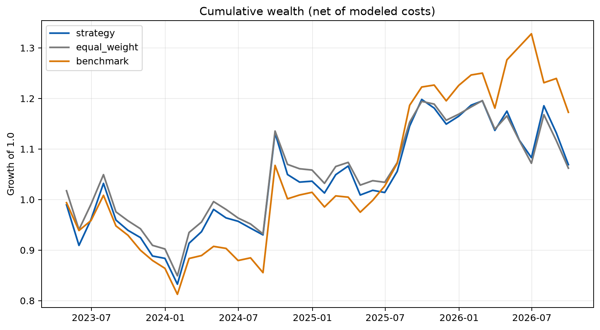

# AuditLens Quant

AuditLens Quant is a point-in-time research project that combines accounting-quality signals with corporate credit-risk analysis to test an A-share defensive equity strategy.

The project is designed around three practical perspectives: audit-style financial statement review, corporate banking credit analysis, and reproducible Python-based quantitative research.

## Research question

Can public accounting-quality and debt-service indicators act as a useful risk filter for a long-only A-share portfolio after accounting for publication dates, turnover, and transaction costs?

The project does **not** assume that the strategy will outperform. All conclusions are generated from the actual backtest.

## Current result snapshot

Data through 2026-09-30 produced 42 monthly observations from 27 companies. The accounting-quality filter modestly improved the static-universe equal-weight portfolio, but it did not beat the CSI 300 ETF proxy.

| Period | Portfolio | Annualized return | Sharpe | Maximum drawdown |
|---|---|---:|---:|---:|
| Full | AuditLens strategy | 1.93% | 0.099 | -19.32% |
| Full | Eligible-universe equal weight | 1.74% | 0.093 | -19.06% |
| Full | CSI 300 ETF proxy | 4.66% | 0.241 | -19.42% |
| 2024 onward | AuditLens strategy | 7.17% | 0.360 | -10.83% |
| 2024 onward | Eligible-universe equal weight | 6.11% | 0.318 | -11.18% |
| 2024 onward | CSI 300 ETF proxy | 11.75% | 0.570 | -11.70% |

These figures are descriptive, not evidence of a durable alpha. The composite score's mean monthly Rank IC was approximately zero, while accrual quality and cash-flow-to-income were the strongest individual signals in this small sample.



## Method

- Uses a transparent static universe of 27 large non-financial A-share companies.
- Builds nine interpretable signals covering cash-flow quality, accruals, profitability, leverage, liquidity, receivables, and inventory.
- Uses reported earnings dates when available and a conservative 120-day fallback lag otherwise.
- Prevents look-ahead by applying month-end signals only to the following month's return.
- Winsorizes and standardizes factors cross-sectionally, with industry neutralization when the group is large enough.
- Compares a strategy that excludes the bottom 20% of companies with an eligible-universe equal-weight portfolio and a liquid CSI 300 ETF proxy (`510300.SS`).
- Models turnover and 10 bps one-way transaction costs.
- Reports full-period and post-2024 out-of-sample results.

## Quick start

The repository was developed with Anaconda Python. Create or activate an environment, then install the project:

```bash
python -m pip install -e ".[dev]"
python -m auditlens all --force
```

To reuse the downloaded cache:

```bash
python -m auditlens run
```

Run tests:

```bash
pytest
```

## Outputs

- `outputs/tables/performance_metrics.csv`: full and out-of-sample metrics
- `outputs/tables/monthly_performance.csv`: monthly strategy, baseline, and benchmark returns
- `outputs/tables/factor_rank_ic.csv`: monthly cross-sectional Rank IC
- `outputs/figures/`: cumulative wealth, drawdown, rolling Sharpe, coverage, and IC figures
- `reports/generated/AuditLens_Quant_Report.md`: automatically generated Chinese research report

Downloaded raw and processed data are excluded from Git. Derived summary tables, charts, and the generated report are retained so the research claims remain inspectable.

## Structure

```text
auditlens-quant/
├── configs/              # Universe and research settings
├── data/                 # Local raw and processed data; ignored by Git
├── docs/                 # Research design and methodology
├── notebooks/            # Recruiter-friendly walkthrough
├── outputs/              # Versioned summary tables and figures
├── reports/generated/    # Versioned generated report
├── src/auditlens/        # Data, factor, backtest, and reporting code
└── tests/                # Leakage, factor-direction, and cost tests
```

## Important limitations

- The initial universe is static and therefore subject to survivorship bias.
- Yahoo Finance may revise historical statement fields.
- Annual statements update slowly and do not represent a high-frequency signal.
- Banks and insurers are excluded because they require a different balance-sheet and capital-adequacy framework.
- This is educational research, not investment advice.

See [`docs/research_design.md`](docs/research_design.md) for formulas, timing rules, and the validation plan.
