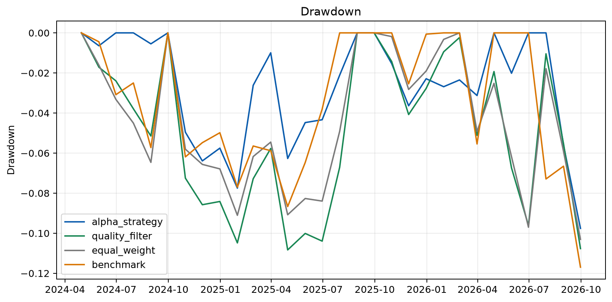
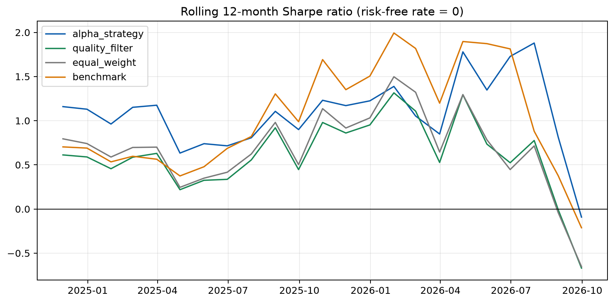
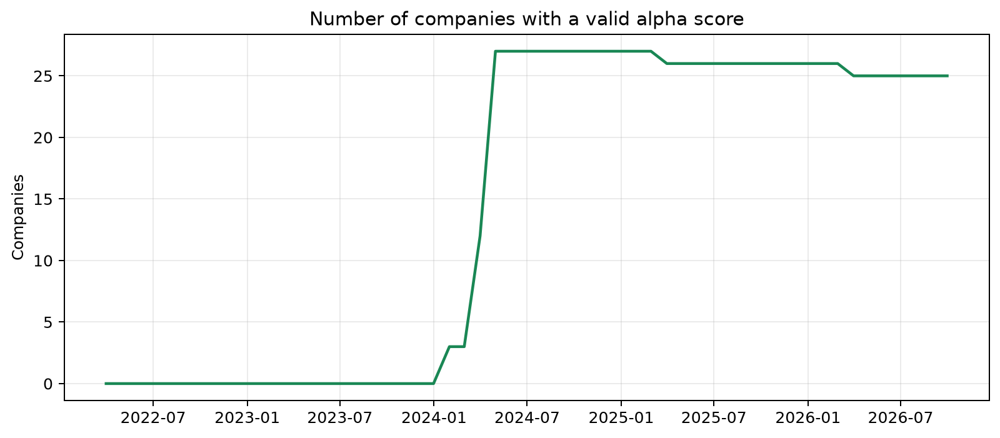
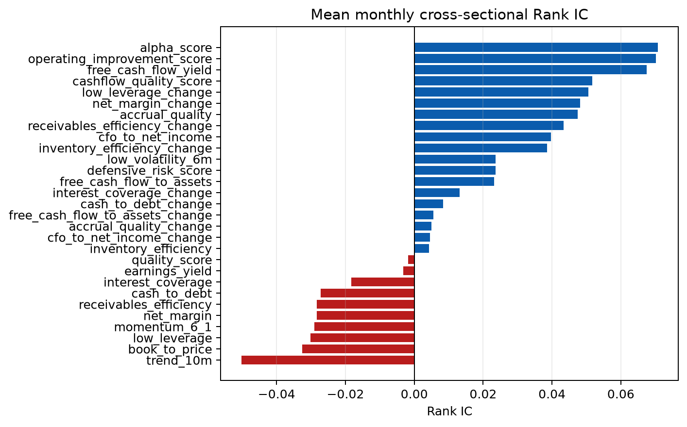

# AuditLens Alpha 回测报告

> 本报告由代码自动生成。结果属于历史研究，不构成投资建议，也不代表未来收益。

## 摘要

- 回测区间：2024-04-30 至 2026-09-30
- 股票池：大型非金融 A 股静态演示股票池；市场基准使用沪深 300 ETF 代理
- Alpha 策略：按现金流质量、经营改善和低波动综合评分，选择最高的 30%（至少 6 只），等权持有
- 第一版对照：排除静态财务质量评分最低的 20%，其余等权
- 交易成本：单边换手 10 bps
- 验证区间起点：2026-01-01（用于模型选择后的稳定性检查，不宣称为完全未触碰测试集）
- 月均有效评分公司数：14.6
- 财报发布日期直接匹配占比：100.00%；其余使用保守滞后规则

## 全区间表现

| 组合 | 年化收益 | 年化波动 | Sharpe | 最大回撤 | Calmar | 月胜率 |
|---|---:|---:|---:|---:|---:|---:|
| alpha_strategy | 16.05% | 18.56% | 0.865 | -9.76% | 1.645 | 56.67% |
| quality_filter | 5.40% | 19.60% | 0.276 | -10.83% | 0.499 | 46.67% |
| equal_weight | 6.56% | 18.92% | 0.347 | -10.31% | 0.636 | 43.33% |
| benchmark | 11.70% | 20.58% | 0.569 | -11.70% | 1.000 | 63.33% |

## 验证区间表现

| 组合 | 年化收益 | 年化波动 | Sharpe | 最大回撤 | Calmar | 月胜率 |
|---|---:|---:|---:|---:|---:|---:|
| alpha_strategy | 0.72% | 13.68% | 0.053 | -9.76% | 0.074 | 44.44% |
| quality_filter | -10.81% | 17.65% | -0.613 | -10.56% | -1.024 | 44.44% |
| equal_weight | -10.30% | 16.12% | -0.639 | -10.31% | -0.999 | 44.44% |
| benchmark | -5.73% | 16.82% | -0.341 | -11.70% | -0.490 | 66.67% |

## 因子与下一月收益的横截面相关

| 因子 | 平均 Rank IC | 有效月份 |
|---|---:|---:|
| alpha_score | 0.071 | 30 |
| operating_improvement_score | 0.070 | 30 |
| free_cash_flow_yield | 0.067 | 42 |
| cashflow_quality_score | 0.052 | 42 |
| low_leverage_change | 0.051 | 30 |
| net_margin_change | 0.048 | 30 |
| accrual_quality | 0.047 | 42 |
| receivables_efficiency_change | 0.043 | 30 |
| cfo_to_net_income | 0.040 | 42 |
| inventory_efficiency_change | 0.039 | 30 |
| low_volatility_6m | 0.024 | 54 |
| defensive_risk_score | 0.024 | 54 |
| free_cash_flow_to_assets | 0.023 | 42 |
| interest_coverage_change | 0.013 | 30 |
| cash_to_debt_change | 0.008 | 30 |
| free_cash_flow_to_assets_change | 0.006 | 30 |
| accrual_quality_change | 0.005 | 30 |
| cfo_to_net_income_change | 0.005 | 30 |
| inventory_efficiency | 0.004 | 42 |
| quality_score | -0.002 | 42 |
| earnings_yield | -0.003 | 42 |
| interest_coverage | -0.018 | 42 |
| cash_to_debt | -0.027 | 42 |
| receivables_efficiency | -0.028 | 42 |
| net_margin | -0.028 | 42 |
| momentum_6_1 | -0.029 | 54 |
| low_leverage | -0.030 | 42 |
| book_to_price | -0.033 | 42 |
| trend_10m | -0.050 | 54 |

Rank IC 为横截面秩相关，只描述历史关系；数值接近零或为负都属于有效研究结果，不应筛选或隐藏。

## 图表

## 主要限制

1. 股票池为静态演示样本，存在幸存者偏差，不能把结果视为完整市场回测。
2. 免费数据源可能回填或修订历史报表；报告保留发布日期来源以便审计。
3. 使用年度报表，基本面信号更新频率较低；月度调仓主要由低波动信号和横截面排序变化驱动。
4. 当前只建模线性交易成本，未完整模拟涨跌停、停牌和大额冲击成本。
5. 当前因子族经过研究样本诊断，2026 年区间也参与了稳定性判断，因此不是完全未触碰测试集；下一阶段必须锁定模型后进行滚动或实时前瞻检验。

## 可复现性

运行 `python -m auditlens all --force` 可重新下载公开数据并生成表格、图表和本报告。原始数据不提交到公开仓库，以遵守数据提供方条款并避免把回填后的快照误认为固定研究样本。
